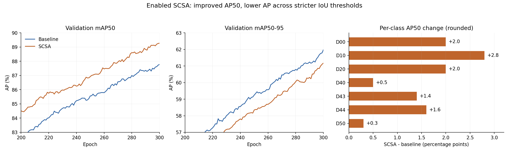

# 有效 SCSA 训练结果与基线对比

本次 SCSA 确实启用，并完成 300 轮训练。mAP50 比基线提高 1.496 个百分点，mAP50–95 降低 0.804 个百分点。该结果支持保留 SCSA 作为后续消融候选，但不足以认定它全面优于基线。

## 结果口径

对比两组 `results.csv` 的第 300 轮验证指标。该轮也是两组各自 mAP50–95 与默认 fitness（0.1×mAP50+0.9×mAP50–95）的最高点，SCSA `best.pt` 保存的指标与此相符。本次没有重新运行数据集验证或独立测试集评估，也没有新增训练。

| 指标 | ResNet18 基线 | ResNet18 + 有效 SCSA | 变化（百分点） |
| --- | ---: | ---: | ---: |
| Precision | 86.433% | 88.067% | +1.634 |
| Recall | 81.595% | 83.139% | +1.544 |
| mAP50 | 87.778% | 89.274% | +1.496 |
| mAP50–95 | 61.977% | 61.173% | -0.804 |

Precision、Recall 是框架选择工作点后的汇总值，不应视为固定置信度阈值下的直接目标计数对比。

## SCSA 启用与训练完成证据

- `best.pt` 与 `last.pt` 均含 8 个 SCSA，通道为 64、64、128、128、256、256、512、512，8 个 `BasicBlock_SCSA.att` 均为 True。
- 最佳权重完成 CPU 640×640 推理，8 个前向钩子各触发一次，输出 `[1,300,11]` 且全部有限。同权重同输入下关闭 SCSA 会改变输出，关闭期间钩子不触发。
- 两个检查点中的 300 轮 `train_results` 逐值匹配原始 CSV。完成后权重被 strip，`epoch=-1` 且不含优化器状态，不能据此误判为未训练。
- 总参数 20,126,124，基线为 20,095,404，新增 30,720（约 0.153%）。参数增加小不代表推理延迟相同，本次未测 GPU 延迟。
- 合并后代码通过 `checks/test_scsa.py` 全部 8 项 CPU 检查，覆盖数量、实际执行、真实检测损失反向传播、参数更新和 640 推理。未运行上游导出、GPU、第三方服务整套集成测试。

详见 [权重核验](checkpoint_verification.json)、[代码检查记录](scsa-checks.xml) 和 [原始文件校验清单](source_manifest.json)。Git 归档实验记录和校验值，权重保留在服务器和本地工作目录，不作为仓库文件上传。

## 训练条件与可比性

两组记录的 batch=8、imgsz=640、epochs=300、seed=0、AdamW、lr0=0.0001、AMP=False、cos_lr=False、lrf=1、close_mosaic=10 及增强配置相同。学习率记录显示预热后保持 0.0001。

SCSA 的 `args.yaml` 记录 nbs=64，基线记录 nbs=8；SCSA 检查点实际训练参数是 nbs=8，与当前训练器在构建优化器前执行 `self.args.nbs=self.batch_size` 一致。因此不能把 YAML 中的 nbs 差异直接当作有效累积 batch 差异。

SCSA 原始代码目录 `/root/autodl-tmp/RT-DETR-SCSA` 在新服务器已不存在。共享盘项目仍是另一份基线工作区，不能用它的 HEAD 或当前 train.py 证明 SCSA 的训练源码。检查点已保存实际模型结构、类别、训练参数和完整指标，但没有保存原始 Git SHA。两组均指向名为 SVRDD 的配置，原始 SCSA 数据 YAML 和训练入口缺失，历史数据划分的逐文件一致性及初始化策略未完全追溯；`pretrained=True` 本身不能证明实际加载了同一份预训练权重。

## 对结果的解释

1. 第 201–300 轮，SCSA 的 mAP50 在全部 100 轮高于基线，mAP50–95 在全部 100 轮低于基线。因此两项指标方向相反，并非仅最后一轮偶然交叉。
2. 最后 20 轮 mAP50–95 均值：基线 61.2757%，SCSA 60.4514%。这些连续轮次不是独立重复实验，不能用它们代替多种子显著性验证。
3. 根据十个 IoU 阈值等权平均的定义，可从汇总指标推得 IoU=0.55–0.95 九个阈值的平均 AP：基线 59.110%，SCSA 58.051%。这表明更严格 IoU 下的平均表现下降，不能进一步推断每个阈值都下降，也不能替代 AP75 或逐类 AP50–95。
4. 最后一轮验证分类损失 0.34095→0.32994，L1 损失 0.10464→0.11547，GIoU 损失 1.1060→1.1189。结合 AP 差异，优先检查定位质量有依据；具体原因仍需逐目标匹配与误差分析，不能据此认定注意力损伤边缘等机制。
5. 按配置，第 291 轮起关闭 Mosaic。第 290→300 轮，mAP50–95 基线增加 0.737 个百分点，SCSA 增加 0.862 个百分点。两组末轮仍在改善，但这只是时间上的相关性，不证明延长训练一定有效。

## 各类别 AP50

下表人工读取各自 PR 图图例，原图仅保留三位小数，故差值为近似值，不用于替代未保存的逐类 AP50–95。

| 类别 | 基线 AP50 | SCSA AP50 | 变化（百分点，约） |
| --- | ---: | ---: | ---: |
| D00 | 86.5% | 88.5% | +2.0 |
| D10 | 83.9% | 86.7% | +2.8 |
| D20 | 92.2% | 94.2% | +2.0 |
| D40 | 84.9% | 85.4% | +0.5 |
| D43 | 88.7% | 90.1% | +1.4 |
| D44 | 90.0% | 91.6% | +1.6 |
| D50 | 88.3% | 88.6% | +0.3 |

七类 AP50 都提高，其中 D10 横向裂缝约 +2.8、D00 纵向裂缝和 D20 网状裂缝各约 +2.0 个百分点；D40 坑槽约 +0.5、D50 修补约 +0.3。

## 下一步实验建议

先保留这次有效 SCSA 结果作为单独对照。下一轮优先在相同数据划分、初始化和评估参数下，导出 baseline 与 SCSA 的逐类 AP50–95、AP75 以及目标尺寸/长宽比分组表现，核实严格 IoU 下的误差集中在哪里。需要对应基线权重和数据；本次只分析现有结果。

若定位差异得到复现，再做“仅较深阶段启用 SCSA”位置消融，例如 C4/C5，检验减少浅层注意力是否有帮助。这是待验证假设，不能承诺涨点。随后再独立考察 FDConv 或融合结构，确认单独作用后组合。最终候选至少用多个随机种子复核，不能仅凭一次 seed=0 将差异归因于模块。

本次合并保存 SCSA 启用修复、专项检查和实验结果。基线 YAML 与默认训练入口继续保留基线行为，合并不等于把 SCSA 设成所有实验的默认配置。
