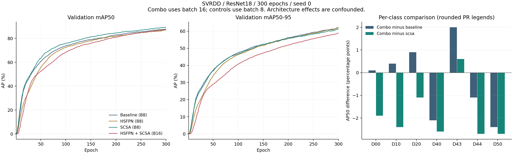

# HSFPN + 有效 SCSA 实验归档与对比（2026-10-18）

本次组合已完成 300 轮，HSFPN 和 8 个 SCSA 均真实启用，但结果没有形成整体提升。**本次实际 batch=16，其余三组 batch=8，因此不能把这四组直接当作只改变网络结构的严格消融，也不能据此断言两个模块组合必然无效。**

## 结果对比

以下均为已有训练日志中的 **SVRDD 验证集**指标，单位为 %，不是本次重新验证或独立测试集结果。四组第 300 轮同时是各自最高 mAP50–95 和最高 `0.1*mAP50 + 0.9*mAP50–95` 的轮次，P/R 与该轮对应。

| 模型 | batch | 轮数 | Precision | Recall | mAP50 | mAP50–95 |
|---|---:|---:|---:|---:|---:|---:|
| ResNet18 基线 | 8 | 300 | 86.433 | 81.595 | 87.778 | 61.977 |
| ResNet18 + HSFPN | 8 | 300 | 86.645 | 79.545 | 87.032 | 62.246 |
| ResNet18 + 有效 SCSA | 8 | 300 | 88.067 | 83.139 | 89.274 | 61.173 |
| ResNet18 + HSFPN + 有效 SCSA（本次） | **16** | 300 | 87.381 | 80.808 | 87.464 | 58.987 |

本次组合相对基线：mAP50 **−0.314 个百分点**，mAP50–95 **−2.990 个百分点**；相对单独 SCSA：分别 **−1.810、−2.186 个百分点**；相对 HSFPN：分别 **+0.432、−3.259 个百分点**。

最后 20 轮平均 mAP50–95：基线 61.276%、HSFPN 61.189%、SCSA 60.451%、本次组合 58.099%。因此差距不只出现在最后一个评估点。组合从第 290 轮到第 300 轮仍增加 1.053 个百分点，不能据此认定已充分收敛。这段改善与最后 10 轮关闭 mosaic 的阶段重合，但现有日志不能分离训练继续进行与关闭增强各自的贡献。



[原始 CSV](run/results.csv) · [训练曲线](run/results.png) · [PR 曲线](run/PR_curve.png) · [矢量对比图](comparison.pdf) · [机器可读统计](analysis.json)

## SCSA 与 HSFPN 是否真正工作

下载原始 `best.pt`、`last.pt`，先核对 SHA-256，再在本地 CPU 加载检查：

- 两个权重均包含 **8 个 `SCSA`、8 个启用注意力的 `BasicBlock_SCSA`、5 个 HSFPN `CA`、2 个转置卷积**，参数量 **19,281,196**，类别数为 7，所有参数均为有限值。
- 两个检查点的完整 300 轮训练记录与 CSV 一致，实际 `train_args.batch=16`、`nbs=16`；网络 backbone/head 与归档模型 YAML 一致。
- `best.pt` 在 640×640 合成输入下执行推理，以上 15 个模块均被钩子记录到一次调用，输出 `[1, 300, 11]` 且无 NaN/Inf。
- 同一权重与输入下关闭 8 个 SCSA 后输出发生变化，最大绝对差约 0.981485。这证明分支参与计算，不代表真实数据准确率提升。
- 完成训练后的权重已经被框架清理优化器，`epoch=-1`、`optimizer=None`。300 轮完成状态由 CSV 和检查点内训练历史确认；这些文件不具备完整断点续训状态。

[详细权重核验](checkpoint_verification.json) · [权重内模型结构](model_from_checkpoint.yaml)

## 为什么本次不能作为严格消融

最明确的额外变量是 **batch 由 8 改为 16**，并非 YAML 中未生效的默认值：原始入口、`args.yaml`、权重三者均证实 batch=16。

本项目训练器将 `nbs` 强制设为实际 batch，因此梯度累积为 1，没有用累积把两种 batch 的优化过程对齐。采集时训练集有 7,393 张图；假定训练集未变、单卡且保留末尾不满批次，batch=8 每轮约 925 次更新，batch=16 约 463 次，300 轮分别约 277,500 与 138,900 次。此为代码和样本数推算，不是保存的逐步日志。

同时，这个分支的 `warmup_epochs=2000` 实际按 **2,000 次迭代**执行，约占 batch=8 的 2.16 轮、batch=16 的 4.32 轮。BatchNorm 统计和梯度噪声也可能变化。这些都是需要控制的因素，**不能由现有证据确定它们解释了多少下降，也不能保证换回 batch=8 就会涨点**。

各组其余保存的优化/增强设置一致，包括 epochs=300、imgsz=640、seed=0、AdamW、lr0=0.0001、lrf=1、cos_lr=False、weight_decay=0.0001、AMP=False、warmup_epochs=2000、初始 mosaic=1.0、close_mosaic=10。路径、模型、实验名、`nbs` 初始记录等差异详见 `analysis.json`。`args.yaml` 写入时的 nbs=64 不等于训练期间的实际值，本次权重中已变为 16。类似地，训练器在最后 10 轮调用 `dataset.close_mosaic(hyp=self.args)`，就地将 mosaic 改成 0；最终权重中的 mosaic=0 表示该阶段的状态，不能当作全程关闭 mosaic 的证据。

历史基线曾断点续训；历史初始化过程、训练时全部源文件与数据内容哈希没有完整留存，不能仅凭 `pretrained=True` 就认定加载了预训练权重，也不能仅凭路径相同证明历次数据完全相同。本次采集的脚本没有调用 `model.load()`，但它是训练后采集的源文件快照。

## 可以得到的研究线索

这次 mAP50 接近基线，而跨 IoU 阈值的 mAP50–95 下降较明显，且验证 GIoU/L1 损失分别为 1.1284/0.11742，高于基线 1.1060/0.10464。后续应重点检查定位质量，但不能仅凭这些汇总量认定定位误差是唯一原因。

分类别 AP50 从保存的 PR 图图例人工读取，只精确到三位小数；下表换算为 %。这些不是分类别 AP75 或 mAP50–95。

| 类别 | 基线 batch8 | SCSA batch8 | 组合 batch16 | 组合−SCSA（百分点，约） |
|---|---:|---:|---:|---:|
| D00 纵向裂缝 | 86.5 | 88.5 | 86.6 | −1.9 |
| D10 横向裂缝 | 83.9 | 86.7 | 84.3 | −2.4 |
| D20 网状裂缝 | 92.2 | 94.2 | 93.1 | −1.1 |
| D40 坑槽 | 84.9 | 85.4 | 82.8 | −2.6 |
| D43 斑马线模糊 | 88.7 | 90.1 | 90.7 | +0.6 |
| D44 井盖 | 90.0 | 91.6 | 88.9 | −2.7 |
| D50 修补 | 88.3 | 88.6 | 85.9 | −2.7 |

下一步优先补一组 **batch=8、其余条件与已有对照一致的 HSFPN+SCSA 从头训练**，完整保留初始化、数据划分与源代码。先固定实验条件，再决定是否保留 HSFPN；不要同时换卷积、改注意力位置和改训练策略。若条件一致后仍明显下降，再针对 D40/D44/D50 和严格 IoU 下的错误样例开展分析，并单独比较融合结构。只有单种子验证集结果，暂不能声称统计显著或独立测试集泛化改善。

仓库根目录 `train.py` 已补齐上次未推送的组合训练入口：默认 batch=8，加入模型启用检查和训练开始时的 `source_snapshot/` 自动保存。**它用于下一次复验，不是本次 batch=16 的原始脚本。** 本次原始入口保存在 [source_snapshot/train.py](source_snapshot/train.py)，本次没有启动新训练、改写服务器入口或更改原始 runs。

## 来源、保留范围与复核

- 来源：`/autodl-fs/data/RT-DETR/runs/resnet18-HSFPN+SCSAEnable`，采集时服务器分支为 `main`，HEAD 为 `7dce80eea33287e7b813676bc4e5bc196576bff1`，工作区有 `M train.py`。这是采集时提交号，不能冒充独立记录的训练时提交号。
- 采集时数据文件数量：train 7,393、valid 2,049、test 2,056，各自图像与标签文件数一致；未进行数据内容一致性或标注质量审计。
- 归档 CSV、args、PR/P/R/F1 曲线和 results.png（共 5 张原始图）、TensorBoard 事件、服务器入口/模型/数据配置/训练器快照、权重内结构及检查记录。完整文件列表与原始哈希见 [source_manifest.json](source_manifest.json)。本次目录未提供混淆矩阵，训练样例图片未复制。
- `best.pt` 和 `last.pt` 保留在服务器，并已下载本地核验；依照仓库现有规则不提交 `.pt` 或数据集，GitHub 保存其大小、原始路径与 SHA-256。哈希是核验标识，不能替代权重备份。
- 两组旧对照 CSV 与服务器核对一致，其中旧 HSFPN 文件需先统一 Windows CRLF 为 LF。新归档用 `.gitattributes` 禁止换行转换以保留原始字节。

在仓库根目录、有项目依赖的环境中执行：

```bash
# 校验原始文件哈希，重新生成统计和图（需要 numpy / matplotlib / PyYAML）
python experiment_reports/2026-10-18-hsfpn-scsa/analyze.py

# 仅加载本次可信且哈希匹配的两个权重；不需要数据集或 GPU
python experiment_reports/2026-10-18-hsfpn-scsa/verify_checkpoint.py /path/to/weights

# 检查下一次 batch=8 训练入口，不启动训练
python train.py --check
python -m pytest checks/test_scsa.py checks/test_train_entrypoint.py -q -o addopts=
```

本地验证环境为 PyTorch 2.0.1+cpu；`train.py --check` 成功，11 项检查全部通过，覆盖四组结构、SCSA 前向/反向/更新、640 输入及训练源文件快照（见 [code-checks.xml](code-checks.xml)）。这些检查不替代服务器 GPU 训练或真实数据集重新评估。
